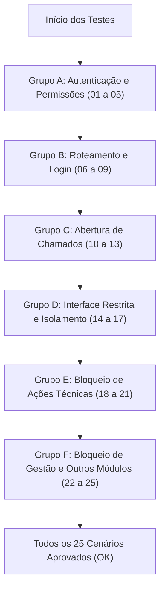

# 🧠 SPEC — NOVO PERFIL DE OPERADOR DA VULCANIZAÇÃO NA MATRIZARIA + DEPLOY AUTOMATIZADO

---

## 📌 1. CONTEXTO

- **URL(s) envolvidas:**
  - `/matrizaria/minhas-solicitacoes/` (Nova interface restrita de chão de fábrica para Operadores de Vulcanização)
  - `/matrizaria/solicitar/` (Abertura de chamados para oficina de matrizaria com autoria fixa de solicitante)
  - `/matrizaria/servicos/<int:pk>/` (Visualização em modo estritamente somente leitura de chamados próprios)
  - `/matrizaria/` (Kanban operacional geral da oficina — restrito a Matrizeiros e Gestão)
  - `/matrizaria/servicos/<int:pk>/[iniciar|transferir|finalizar|conferir|cancelar|editar|excluir]/` (Ações operacionais da oficina — bloqueadas para Operadores de Vulcanização)
  - `/matrizaria/relatorios/` e `/matrizaria/relatorios/exportar-excel/` (Relatórios e exportações — bloqueados)
  - `/matrizaria/tv/` e `/matrizaria/api/tv-data/` (Painel contínuo de TV — bloqueado para operadores de chão de fábrica)
  - `/` (`home_redirect`) e `/portal_select/` (Fluxo de roteamento e seleção de módulos)
  - `/management/`, `/producao/`, `/bladder/` (Demais módulos do sistema — isolados e protegidos)
- **Contexto(s):** Módulo de Matrizaria Industrial, Chão de Fábrica (Vulcanização / Prensas), Autenticação e Autorização Django, Deploy Automatizado no Windows Server 2019.
- **Perfil(s) afetados:**
  - `Operadores Vulcanização` (Grupo dedicado de chão de fábrica com permissão exclusiva de abertura e acompanhamento de seus chamados)
  - `Matrizaria` (Matrizeiros que executam os serviços)
  - `Liderança de Produção` / `Líderes` (Liderança autorizada a conferir/aprovar e gerenciar)
  - Superusuários (`is_superuser=True`) e Administradores.

---

## ❗ 2. PROBLEMA ATUAL

1. **Insegurança e Ambiguidade nas Permissões do Grupo `Operadores Vulcanização`:**
   - Em `matrizaria/decorators.py`, a função `_user_can_inspect_matrizaria` inclui indevidamente o grupo `"Operadores Vulcanização"`. Isso permitiria que operadores de vulcanização conferissem/aprovassem serviços concluídos na matrizaria, violando a segregação de funções entre quem solicita e quem inspeciona/libera o molde.
   - A função `_user_can_view_matrizaria_tv` também inclui `"Operadores Vulcanização"`, expondo dados operacionais globais que não pertencem ao escopo do operador de linha.
   - Não há um helper canônico dedicado (`_user_is_operador_vulcanizacao` ou `_user_can_access_matrizaria_kanban`) para diferenciar operadores de chão de fábrica de usuários técnicos da oficina.

2. **Falta de Interface Restrita e Vazamento de Dados no Kanban:**
   - Atualmente, qualquer usuário com acesso ao módulo de Matrizaria é direcionado para a rota `/matrizaria/` (Kanban Geral).
   - No Kanban geral, são exibidas todas as ordens de serviço da fábrica (Solicitados, Em Execução, Aguardando Conferência e Concluídos de todas as máquinas e setores), permitindo que um operador consulte solicitações de terceiros e detalhes internos de oficina.
   - O operador de vulcanização não possui uma tela limpa, responsiva (mobile-friendly) e restrita onde visualize apenas as solicitações abertas por ele mesmo.

3. **Vulnerabilidade de Acesso Direto por URL e Ações Operacionais:**
   - Na view `detalhe_servico_view` (`/matrizaria/servicos/<pk>/`), um operador pode visualizar detalhes de chamados de terceiros digitando o ID na URL.
   - As flags `can_editar` e `can_excluir` em `detalhe_servico_view` utilizam `is_solicitante_proprio` associado a `user_can_sol`, permitindo que o operador submeta alterações de chamados após criados, quando a diretriz de governança exige que operadores de vulcanização tenham visão estritamente somente leitura de suas solicitações.

4. **Roteamento Inadequado no Login:**
   - Ao efetuar login, a view `home_redirect` e o hub `portal_select` em `maintenance/views.py` direcionam usuários da Matrizaria indistintamente para `matrizaria:kanban`. O operador de vulcanização deveria ser encaminhado diretamente para sua tela de chamados próprios (`/matrizaria/minhas-solicitacoes/`).

5. **Deploy Manual e Risco Operacional no Windows Server:**
   - O procedimento atual no Windows Server 2019 requer execução manual de comandos de migração, coleta de estáticos e inicialização de serviços.
   - Não há um script PowerShell unificado (`scripts/deploy_production.ps1`) que execute verificações prévias (preflight), backup preventivo do banco e arquivos, aplicação de migrações estritas no banco `default`, provisionamento idempotente de grupos, inicialização segura de serviços (Waitress e Coletor Scada sem duplicidade de instâncias ou conflitos de porta) e validações pós-deploy (smoke tests, locks e logs).

---

## 🎯 3. OBJETIVO

1. **Matriz de Permissões Canônica e Blindada:**
   - Configurar o grupo `Operadores Vulcanização` com permissões mínimas e necessárias:
     - **Permitido:** Login no sistema, abertura de chamados na Matrizaria (`/matrizaria/solicitar/`), consulta exclusiva de suas próprias solicitações em modo somente leitura (`/matrizaria/minhas-solicitacoes/` e `/matrizaria/servicos/<pk>/` se `solicitado_por == request.user`).
     - **Negado:** Kanban geral (`/matrizaria/`), chamados de terceiros, iniciar execução, transferir responsabilidade, finalizar execução, conferir/aprovar serviços, cancelar chamados, editar chamados, excluir chamados, relatórios analíticos, exportação em Excel, painel de TV e qualquer outro módulo (`maintenance`, `production`, `bladder`, `/admin/`).
   - Corrigir os helpers em `matrizaria/decorators.py`, removendo `"Operadores Vulcanização"` de `_user_can_inspect_matrizaria` e `_user_can_view_matrizaria_tv`.
   - Criar helpers canônicos `_user_is_operador_vulcanizacao`, `_user_is_exclusively_operador_vulcanizacao` e `_user_can_access_matrizaria_kanban`.

2. **Nova Interface Dedicada do Operador (`/matrizaria/minhas-solicitacoes/`):**
   - Criar rota e view restrita `minhas_solicitacoes_operador_view` filtrando exclusivamente `SolicitacaoServicoMatrizaria.objects.filter(solicitado_por=request.user)`.
   - Layout mobile-friendly, intuitivo para uso em tablets e celulares no chão de fábrica, com botão de destaque "Nova Solicitação", cards informativos (Total, Abertas, Em Execução, Concluídas), filtros rápidos de status e listagem clara.
   - Reutilizar `SolicitacaoServicoForm`, garantindo no backend que `solicitado_por` seja fixado em `request.user` sem possibilidade de adulteração.
   - Blindar o detalhe `/matrizaria/servicos/<pk>/`: caso o chamado pertença a terceiro, bloquear com HTTP 403 Forbidden ou redirecionamento seguro com mensagem de erro; caso seja próprio, renderizar em modo estritamente somente leitura (sem formulários ou botões de ação).

3. **Roteamento Inteligente no Login e Portal:**
   - Em `maintenance/views.py` (`home_redirect` e `portal_select`), direcionar o operador de vulcanização exclusivo automaticamente para `/matrizaria/minhas-solicitacoes/`.
   - No portal de módulos (usuários com múltiplos acessos), o card da Matrizaria deve apontar dinamicamente para `matrizaria:minhas_solicitacoes` quando o usuário for operador de vulcanização exclusivo.
   - Na barra de navegação da Matrizaria, exibir "Minhas Solicitações" em vez de "Kanban" e ocultar links de relatórios e TV.

4. **Migração e Provisionamento Idempotente:**
   - Criar migration de dados no app `matrizaria` com `RunPython` e APIs históricas para provisionar o grupo `Operadores Vulcanização` com permissões exatas no banco `default`.
   - Ajustar o comando `provisionar_grupos_matrizaria.py` para garantir 100% de idempotência, compatibilidade multi-banco e higienização de permissões obsoletas.

5. **Deploy Automatizado no Windows Server (`scripts/deploy_production.ps1`):**
   - Desenvolver script PowerShell estruturado em 5 etapas rigorosas:
     1. *Pré-verificação:* Python 3.11 no `.venv`, `.env`, integridade Django (`manage.py check`), Git.
     2. *Segurança/Backup:* Cópia preventiva de `db.sqlite3`, `.env`, `media/` e sessões com validação de integridade.
     3. *Aplicação das Alterações:* `migrate --database=default`, `provisionar_grupos_matrizaria`, `collectstatic`.
     4. *Inicialização Sem Duplicidade:* Gerenciamento via NSSM ou processos em background, garantindo liberação prévia de portas e controle de lock.
     5. *Pós-verificação (Smoke Tests):* Validação de porta 8900 ativa, teste HTTP 200 em `/login/`, validação de locks e rotação de logs.
   - Suporte completo a parâmetros `-DryRun` e `-CheckOnly`.

---

## 🧩 4. ESCOPO DA ALTERAÇÃO

### Módulos Afetados:
- `matrizaria`
- `maintenance`
- `scripts`

### Arquivos a Modificar / Criar:

| Arquivo | Ação | Responsabilidade |
|---|---|---|
| `matrizaria/decorators.py` | Modificar | Remover `Operadores Vulcanização` de `_user_can_inspect_matrizaria` e `_user_can_view_matrizaria_tv`; criar `_user_is_operador_vulcanizacao`, `_user_is_exclusively_operador_vulcanizacao`, `_user_can_access_matrizaria_kanban` e decorator `matrizaria_kanban_required`. |
| `matrizaria/views.py` | Modificar | Criar view `minhas_solicitacoes_operador_view`; proteger `kanban_view` com `matrizaria_kanban_required`; blindar `detalhe_servico_view` contra acesso a chamados de terceiros e desabilitar botões/ações para operador; bloquear `editar_solicitacao_view` para operador. |
| `matrizaria/urls.py` | Modificar | Registrar rota `minhas-solicitacoes/` (`name="minhas_solicitacoes"`). |
| `matrizaria/templates/matrizaria/minhas_solicitacoes.html` | Criar | Interface mobile-friendly de chão de fábrica do operador com lista de solicitações próprias, badges de status, stat-cards e botão "Nova Solicitação". |
| `matrizaria/templates/matrizaria/base_matrizaria.html` | Modificar | Ajustar navegação e link de marca: exibir "Minhas Solicitações" para operadores, ocultar Kanban, Relatórios e TV para perfis não autorizados. |
| `matrizaria/templates/matrizaria/detalhe_solicitacao.html` | Modificar | Ajustar botão de retorno ("Voltar") para apontar para `minhas_solicitacoes` quando o usuário for operador de vulcanização exclusivo. |
| `matrizaria/templates/matrizaria/form_solicitacao.html` | Modificar | Ajustar botão de cancelamento/voltar para retornar a `minhas_solicitacoes` para operadores. |
| `maintenance/views.py` | Modificar | Ajustar `home_redirect` e `portal_select` para rotear operadores de vulcanização para `matrizaria:minhas_solicitacoes` e alimentar `matrizaria_url` dinamicamente no contexto. |
| `maintenance/templates/maintenance/portal_select.html` | Modificar | Atualizar link do card da Matrizaria para usar ``. |
| `maintenance/context_processors.py` | Modificar | Disponibilizar flags `can_access_matrizaria_kanban` e `is_operador_vulcanizacao` globalmente para os templates. |
| `matrizaria/migrations/0004_provisionar_grupo_operadores_vulcanizacao.py` | Criar | Migration de dados `RunPython` com APIs históricas provisionando o grupo e permissões no banco `default`. |
| `matrizaria/management/commands/provisionar_grupos_matrizaria.py` | Modificar | Tornar comando idempotente com suporte a `--database` e higienização estrita de permissões. |
| `scripts/deploy_production.ps1` | Criar | Script automatizado de deploy no Windows Server em 5 etapas com `-DryRun` e `-CheckOnly`. |
| `matrizaria/tests.py` | Modificar | Implementar suíte de testes automatizados cobrindo os 25 cenários da especificação. |

---

## 🚫 5. FORA DE ESCOPO

- NÃO permitir que operadores de vulcanização visualizem solicitações de outros colaboradores.
- NÃO permitir que operadores de vulcanização executem serviços técnicos, aprovem, confiram, alterem ou cancelem chamados.
- NÃO alterar a lógica central do motor de transições de status da Matrizaria (`MatrizariaService`).
- NÃO criar banco de dados ou tabelas separadas para o operador — reutilizar integralmente o modelo `SolicitacaoServicoMatrizaria`.
- NÃO executar migrações ou escritas no banco `scada` (banco de telemetria estritamente somente leitura).
- NÃO alterar os fluxos dos módulos `maintenance`, `production` ou `bladder`.
- NÃO criar ambientes virtuais adicionais (`.venv2`, etc.).

---

## 🔐 6. REGRAS OBRIGATÓRIAS (CONSTITUTION)

⚠️ Esta implementação DEVE obedecer rigorosamente ao `constitution.md`:

1. **Apenas 1 ambiente virtual (`.venv`)** e 1 projeto Django ativo.
2. **Segurança e Validação no Backend:** Nunca confiar em requisições de frontend; validar permissões e posse de objeto (`solicitado_por == request.user`) diretamente na view.
3. **ORM do Django Sempre:** Nenhuma consulta SQL direta (`raw`, `.extra()`).
4. **Isolamento Multi-Banco:** Migrações e escritas executadas EXCLUSIVAMENTE no banco de dados `default`. Banco `scada` é estritamente read-only.
5. **Proteção CSRF:** Obrigatória em todas as ações POST.
6. **Prevenção de Idempotência:** Manter verificação de `idempotency_key` no formulário de solicitação para evitar duplicidade de chamados por duplo clique.

---

## ⚙️ 7. REGRAS DE NEGÓCIO

### 7.1 Matriz de Permissões Canônica

| Funcionalidade / Rota | Operadores Vulcanização | Matrizaria (Oficina) | Liderança de Produção | Superuser / Admin |
|---|:---:|:---:|:---:|:---:|
| **Login no Sistema** | ✅ Permitido | ✅ Permitido | ✅ Permitido | ✅ Permitido |
| **Minhas Solicitações (`/minhas-solicitacoes/`)** | ✅ Permitido | ✅ Permitido | ✅ Permitido | ✅ Permitido |
| **Abrir Solicitação (`/solicitar/`)** | ✅ Permitido | ❌ Negado | ✅ Permitido | ✅ Permitido |
| **Ver Detalhe de Solicitação Própria** | ✅ (Somente Leitura) | ✅ (Operacional) | ✅ (Operacional) | ✅ (Total) |
| **Ver Detalhe de Solicitação de Terceiro** | ❌ Negado (403/Redirect) | ✅ Permitido | ✅ Permitido | ✅ Permitido |
| **Kanban Geral (`/matrizaria/`)** | ❌ Negado (Redirect) | ✅ Permitido | ✅ Permitido | ✅ Permitido |
| **Iniciar / Executar Atendimento** | ❌ Negado | ✅ Permitido | ❌ Negado | ✅ Permitido |
| **Transferir Responsabilidade** | ❌ Negado | ✅ Permitido | ❌ Negado | ✅ Permitido |
| **Finalizar Execução Técnica** | ❌ Negado | ✅ Permitido | ❌ Negado | ✅ Permitido |
| **Conferir / Aprovar Serviço** | ❌ Negado | ❌ Negado | ✅ Permitido | ✅ Permitido |
| **Cancelar Solicitação** | ❌ Negado | ❌ Negado | ✅ Permitido | ✅ Permitido |
| **Editar Solicitação Pendente** | ❌ Negado | ❌ Negado | ✅ Permitido | ✅ Permitido |
| **Excluir Solicitação Pendente** | ❌ Negado | ❌ Negado | ❌ Negado | ✅ Permitido |
| **Relatórios e Exportação Excel** | ❌ Negado | ❌ Negado | ✅ Permitido | ✅ Permitido |
| **Painel de TV da Matrizaria** | ❌ Negado | ✅ Permitido | ✅ Permitido | ✅ Permitido |
| **Módulos Manutenção / Produção / Bladder** | ❌ Negado | ❌ Negado | Conforme perfil | ✅ Permitido |

### 7.2 Regras de Autoria e Abertura
- Ao abrir um chamado em `/matrizaria/solicitar/`, o campo `solicitado_por` DEVE ser atribuído internamente a `request.user`. Qualquer campo ou parâmetro enviado no POST tentando definir outro solicitante DEVE ser ignorado.
- Destino do chamado pode ser uma prensa de vulcanização real ou serviço interno (`"MATRIZARIA"`).
- Após submissão bem-sucedida, se o usuário for operador de vulcanização exclusivo, redirecionar para `/matrizaria/minhas-solicitacoes/` com mensagem `messages.success`.

### 7.3 Regras de Consulta e Visualização
- Na rota `/matrizaria/minhas-solicitacoes/`, a query DEVE ser estritamente filtrada por `solicitado_por=request.user`. O operador NUNCA deve ver registros criados por outros usuários.
- Na rota `/matrizaria/servicos/<pk>/`, caso o usuário seja operador de vulcanização exclusivo e `solicitacao.solicitado_por != request.user`, a view DEVE retornar HTTP 403 Forbidden ou redirecionar para `/matrizaria/minhas-solicitacoes/` com mensagem de erro amigável (`messages.error`).
- Caso `solicitacao.solicitado_por == request.user`, a view renderiza o template com todas as ações operacionais desabilitadas (`can_executar=False`, `can_conferir=False`, `can_cancelar=False`, `can_editar=False`, `can_excluir=False`), garantindo que o chamado seja apenas inspecionado.

### 7.4 Regras de Roteamento de Entrada
- Usuários autenticados cujo perfil seja exclusivamente `Operadores Vulcanização`:
  - `home_redirect`: Redireciona diretamente para `matrizaria:minhas_solicitacoes`.
  - `portal_select`: Se o usuário só possuir acesso à Matrizaria, redireciona para `matrizaria:minhas_solicitacoes`. Se possuir múltiplos módulos autorizados, o card da Matrizaria exibe link para `matrizaria:minhas_solicitacoes`.
  - Acesso direto à rota raiz `/matrizaria/`: Redireciona automaticamente para `/matrizaria/minhas-solicitacoes/`.

---

## 🧪 8. CRITÉRIOS DE ACEITAÇÃO

A implementação será considerada aceita se, e somente se:

- [ ] **Grupo e Permissões:** O grupo `Operadores Vulcanização` é provisionado de forma idempotente com permissões restritas a `view/add` em solicitações e `view` em matrizes/tipos.
- [ ] **Correção de Decorators:** `_user_can_inspect_matrizaria` e `_user_can_view_matrizaria_tv` NÃO incluem mais `Operadores Vulcanização`.
- [ ] **Helpers Canônicos:** `_user_is_operador_vulcanizacao`, `_user_is_exclusively_operador_vulcanizacao` e `_user_can_access_matrizaria_kanban` operam com precisão.
- [ ] **Interface Restrita Funcional:** A rota `/matrizaria/minhas-solicitacoes/` lista apenas as solicitações do próprio usuário logado, com visual mobile-friendly e estatísticas corretas.
- [ ] **Isolamento de Chamados de Terceiros:** Acesso direto via URL `/matrizaria/servicos/<pk>/` de chamados de outros usuários é terminantemente bloqueado.
- [ ] **Modo Somente Leitura:** Chamados próprios em `/matrizaria/servicos/<pk>/` não exibem nenhum botão ou formulário de início, transferência, finalização, conferência, cancelamento, edição ou exclusão para o operador.
- [ ] **Bloqueio de Ações POST:** Tentativas forjadas de POST em qualquer rota técnica retornam erro ou redirecionamento de permissão.
- [ ] **Bloqueio de Kanban, TV e Relatórios:** O operador de vulcanização não consegue acessar `/matrizaria/`, `/matrizaria/tv/`, `/matrizaria/relatorios/` nem exportações Excel.
- [ ] **Roteamento de Login:** Operador de vulcanização exclusivo vai direto para `minhas-solicitacoes` após o login.
- [ ] **Deploy Script Homologado:** `scripts/deploy_production.ps1` executa as 5 etapas, suporta `-DryRun` e `-CheckOnly`, previne concorrência/port locks e valida a saúde do sistema.
- [ ] **Testes Automatizados:** Todos os 25 cenários de teste são implementados e executados com status `OK`.

---

## ⚠️ 9. RISCOS E MITIGAÇÕES

| Risco | Impacto | Mitigação |
|---|---|---|
| Quebra de compatibilidade com Líderes ou Matrizeiros existentes | Médio | Criar a verificação `_user_is_exclusively_operador_vulcanizacao` para que usuários que acumulam papéis (ex: Líder de Produção + Vulcanização) continuem com suas permissões plenas de liderança. |
| Operador tentar forjar `solicitado_por` em requisições POST | Alto | O campo é injetado diretamente a partir de `request.user` no backend; qualquer dado do payload HTTP referente ao solicitante é desconsiderado. |
| Inconsistência de permissões entre ambientes SQLite e MySQL | Alto | Usar migration de dados `RunPython` com APIs do ORM Django (`Group`, `Permission`, `ContentType`), garantindo compatibilidade multiplataforma. |
| Duplicação de processos Waitress ou Coletor Scada no Windows Server | Alto | O script de deploy verifica a porta 8900 via `Get-NetTCPConnection`, encerra graciosamente processos anteriores e valida o lock `scada_collector.lock`. |
| Perda de dados durante deploy em produção | Crítico | Etapa 2 de backup preventivo obrigatória antes de qualquer comando de migração ou reinicialização. |

---

## 🔍 10. PLANO DE IMPLEMENTAÇÃO (OBRIGATÓRIO)

### Fase 1: Arquitetura e Especificação (Subagente Arquiteto)
1. Analisar código atual de permissões, decorators, views e scripts.
2. Definir a matriz de permissões detalhada e desenhar a arquitetura da interface restrita.
3. Criar formalmente a especificação em `regras_programacao/SPEC_ACESSO_OPERADORES_VULCANIZACAO_MATRIZARIA.md`.

### Fase 2: Backend e Permissões (Subagente Backend)
1. **Decorators e Helpers (`matrizaria/decorators.py`):**
   - Remover `"Operadores Vulcanização"` de `_user_can_inspect_matrizaria` e `_user_can_view_matrizaria_tv`.
   - Implementar `_user_is_operador_vulcanizacao`, `_user_is_exclusively_operador_vulcanizacao`, `_user_can_access_matrizaria_kanban` e decorator `matrizaria_kanban_required`.
2. **Nova Rota e View (`matrizaria/urls.py` e `matrizaria/views.py`):**
   - Criar `minhas_solicitacoes_operador_view` com paginação e filtros.
   - Decorar `kanban_view` com `@matrizaria_kanban_required`.
   - Atualizar `detalhe_servico_view`: bloquear solicitações de terceiros para operadores exclusivos; anular flags de ação para chamados próprios.
   - Bloquear `editar_solicitacao_view` para operadores exclusivos.
   - Atualizar redirecionamento pós-abertura em `solicitar_servico_view` para direcionar operadores de vulcanização para `minhas_solicitacoes`.
3. **Templates do Módulo de Matrizaria:**
   - Criar `matrizaria/templates/matrizaria/minhas_solicitacoes.html`.
   - Ajustar `matrizaria/templates/matrizaria/base_matrizaria.html`, `detalhe_solicitacao.html` e `form_solicitacao.html` (navegação e botões voltar).
4. **Fluxo de Login e Contexto Global (`maintenance/views.py` e `context_processors.py`):**
   - Atualizar `home_redirect` e `portal_select` para rotear operadores de vulcanização para `minhas_solicitacoes`.
   - Atualizar `portal_select.html` para utilizar `matrizaria_url`.
   - Atualizar `module_access_context` em `context_processors.py`.
5. **Migração e Provisionamento:**
   - Criar migration `0004_provisionar_grupo_operadores_vulcanizacao.py`.
   - Ajustar `provisionar_grupos_matrizaria.py` com parâmetro `--database` e idempotência plena.
6. **Script de Deploy Automatizado (`scripts/deploy_production.ps1`):**
   - Implementar as 5 etapas com suporte a `-DryRun` e `-CheckOnly`.

### Fase 3: Qualidade, Verificação e Testes (Subagente QA)
1. Implementar e executar a suíte de testes com os 25 cenários em `matrizaria/tests.py`.
2. Validar que nenhuma regressão foi introduzida nas 61 suites de testes existentes.
3. Testar script de deploy em modo `-CheckOnly` e `-DryRun`.
4. Registrar o log de alterações no protocolo `Instrucoes.txt`.

---

## 🧪 11. PLANO DE TESTES (25 CENÁRIOS OBRIGATÓRIOS)

### Detalhamento dos 25 Cenários:

1. **`test_01_grupo_operadores_vulcanizacao_provisionado`:** Valida que o grupo "Operadores Vulcanização" é criado no banco default via migration/command.
2. **`test_02_grupo_possui_permissoes_estritas_solicitacao`:** Valida presença exclusiva de `view_solicitacaoservicomatrizaria` e `add_solicitacaoservicomatrizaria`.
3. **`test_03_grupo_possui_permissoes_leitura_matriz_e_tipo`:** Valida presença de `view_matrizfisica` e `view_tiposervicomatrizaria`.
4. **`test_04_grupo_nao_possui_permissoes_privilegiadas`:** Valida que o grupo NÃO possui `change_solicitacaoservicomatrizaria`, `delete_solicitacaoservicomatrizaria` nem permissões em ciclos.
5. **`test_05_helper_user_is_operador_vulcanizacao`:** Testa que o helper retorna `True` para membros do grupo e `False` para outros.
6. **`test_06_helper_user_can_access_matrizaria_kanban_bloqueia_vulcanizacao`:** Testa que `_user_can_access_matrizaria_kanban` retorna `False` para operador de vulcanização exclusivo e `True` para matrizeiros/líderes.
7. **`test_07_home_redirect_operador_vulcanizacao_vai_para_minhas_solicitacoes`:** Usuário exclusivo de vulcanização é redirecionado por `home_redirect` para `/matrizaria/minhas-solicitacoes/`.
8. **`test_08_portal_select_operador_vulcanizacao_redireciona_direto`:** Acesso a `portal_select` por operador de vulcanização exclusivo redireciona direto para `/matrizaria/minhas-solicitacoes/`.
9. **`test_09_portal_select_dual_access_card_aponta_minhas_solicitacoes`:** Usuário com dual access (Vulcanização + Produção) recebe `matrizaria_url` apontando para `minhas_solicitacoes`.
10. **`test_10_operador_vulcanizacao_acessa_formulario_solicitar_sucesso`:** GET em `/matrizaria/solicitar/` retorna HTTP 200 para operador de vulcanização.
11. **`test_11_abertura_solicitacao_define_solicitado_por_automatico`:** POST de criação salva a solicitação com `solicitado_por == request.user`.
12. **`test_12_abertura_solicitacao_ignora_injecao_outro_solicitante`:** Tentativa de enviar outro ID no payload POST não altera o solicitante real.
13. **`test_13_abertura_solicitacao_redireciona_com_sucesso`:** Abertura com sucesso redireciona para `matrizaria:minhas_solicitacoes` com mensagem de sucesso.
14. **`test_14_operador_acessa_minhas_solicitacoes_sucesso`:** GET em `/matrizaria/minhas-solicitacoes/` retorna HTTP 200 e lista solicitações próprias.
15. **`test_15_minhas_solicitacoes_isola_solicitacoes_de_terceiros`:** Solicitações de outros operadores NÃO aparecem na tela do operador.
16. **`test_16_detalhe_propria_solicitacao_somente_leitura`:** Detalhe de solicitação própria carrega em HTTP 200 com todas as flags de ação desativadas (`can_executar=False`, `can_conferir=False`, etc.).
17. **`test_17_detalhe_solicitacao_terceiros_bloqueado`:** Operador tentando acessar detalhe de chamado de terceiro recebe bloqueio (403 ou redirecionamento com erro).
18. **`test_18_kanban_geral_bloqueado_para_operador_vulcanizacao`:** Operador tentando acessar `/matrizaria/` é redirecionado para `/matrizaria/minhas-solicitacoes/`.
19. **`test_19_iniciar_atendimento_bloqueado_para_operador_vulcanizacao`:** POST em `/servicos/<pk>/iniciar/` por operador de vulcanização é bloqueado.
20. **`test_20_transferir_e_finalizar_bloqueados_para_operador_vulcanizacao`:** POSTs em `/transferir/` e `/finalizar/` são bloqueados.
21. **`test_21_conferir_aprovacao_bloqueado_para_operador_vulcanizacao`:** POST em `/servicos/<pk>/conferir/` é bloqueado com erro de permissão.
22. **`test_22_editar_e_cancelar_bloqueados_para_operador_vulcanizacao`:** POSTs em `/editar/` e `/cancelar/` são bloqueados para o operador.
23. **`test_23_relatorios_matrizaria_bloqueados_para_operador_vulcanizacao`:** GET em `/relatorios/` e `/relatorios/exportar-excel/` são bloqueados.
24. **`test_24_painel_tv_matrizaria_bloqueado_para_operador_vulcanizacao`:** GET em `/tv/` e `/api/tv-data/` são bloqueados.
25. **`test_25_modulos_manutencao_producao_bladder_bloqueados`:** Operador de vulcanização tentando acessar `/management/`, `/producao/` e `/bladder/` recebe acesso negado.

---

## 📂 12. EVIDÊNCIAS OBRIGATÓRIAS DO AGENTE

Ao término da implementação e testes, os subagentes registrarão:

### Arquivos lidos:
- Lista detalhada de arquivos analisados na elaboração e execução.

### Arquivos alterados / criados:
- Lista dos arquivos modificados e novos arquivos gerados.

### Alterações feitas:
- Resumo objetivo das modificações realizadas por componente.

### Justificativa:
- Demonstração do cumprimento de cada regra da Constituição e da SPEC.

---

# 🤖 ORQUESTRAÇÃO DE SUBAGENTES

1. **Subagente Arquiteto (Etapa Atual):**
   - Mapeamento das regras, arquitetura do fluxo de permissões, desenho da tela restrita, estratégia do script de deploy e formalização da SPEC.
2. **Subagente Backend (Próxima Etapa):**
   - Implementação fiel das views, decorators, templates, migrations, commands e do script `scripts/deploy_production.ps1`.
3. **Subagente QA (Etapa Final):**
   - Execução dos 25 testes automatizados, validação de não regressão (61 testes existentes), smoke test do script de deploy e atualização de `Instrucoes.txt`.

---

# 🧠 PRINCÍPIO FINAL

> "Alterar o mínimo possível para resolver o problema com segurança."
- Segurança > velocidade  
- Clareza > complexidade  
- Consistência > criatividade
